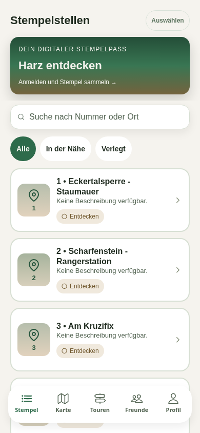
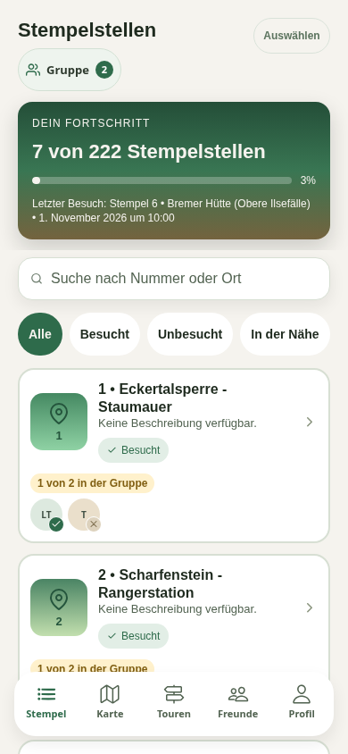
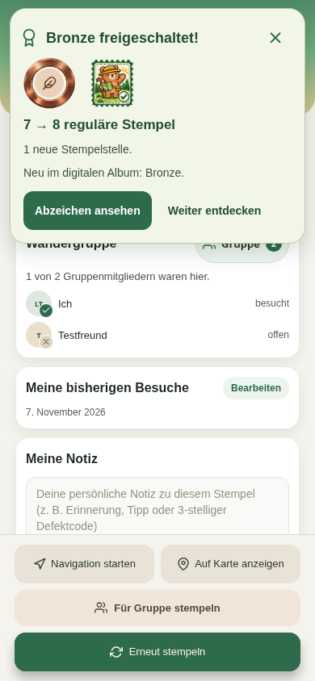
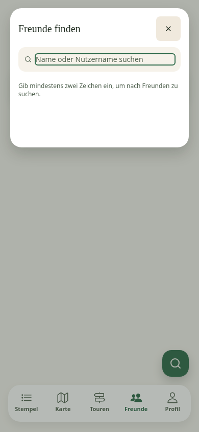

# UX, Abzeichen und Stempelerfolg: gemeinsamer Integrationsstand

#118 enthält den aktuellen develop-Stand `7513b1b` sowie #65 (`003218d`). **#65 zuerst integrieren**, danach #118 gegen develop erneut prüfen, insbesondere nach einem Squash-Merge. Der UX-PR behält seine Zielbranch develop; sein Diff enthält bis zur Integration der Vorbedingung auch deren Funktionen. Reiner UX-/Integrationsvergleich: `003218d...design/ux-ui-review`.

Die sechs Konfliktdateien wurden so aufgelöst, dass Abzeichen-Zielfilter, gemeinsamer Profil-/Fotoeditor und serverbestätigter Stempelerfolg erhalten bleiben. Suchfokus, Gastfilter, responsives Layout und reduzierte Bewegung aus dem UX-Stand bleiben aktiv. Freunde und Onboarding verwenden denselben Suchdialog und dieselbe Anfrageverwaltung. Der gemeinsame Dialog übernimmt löschbare Suche, zugängliche Benennung und 48-dp-Aktionen; der alte Profileditor leitet zum gemeinsamen Editor weiter.

## Aktuelle Prüfung

- 421 App-Tests in 80 Suites, 57 Backend-Tests und 43 Release-Automationstests erfolgreich.
- TypeScript, gezieltes ESLint und vollständiger Basic-Webexport erfolgreich.
- Vollständige App mit echter lokaler Basic-Anmeldung und isolierter In-Memory-Datenbank: 222 öffentliche Repository-Stempelstellen, sieben eigene Testbesuche und eine bestätigte synthetische Freundschaft.
- Gastansicht bei 320 × 568, 390 × 844 und 1440 × 900 ohne horizontalen Überlauf; Suche leeren funktioniert.
- Gruppenwahl per Leertaste, Entwurf beim Schließen verwerfen und erst mit Fertig übernehmen erfolgreich.
- Im integrierten Layout tatsächlich gestempelt: persönlicher Fortschritt 7 → 8 und Bronze-Erfolgskarte. Kein gemocktes Erfolgsereignis.
- Keine JavaScript-Seitenfehler. Prüfwerte: [JSON](current-develop-integration.json).

## Aufnahmen

Alle Aufnahmen sind Web-Prüfungen mit Testdaten. Bestehende Nachweise des Karten-Vollbildwechsels bleiben in [hero-tour-validation.md](hero-tour-validation.md) mit ihrem jeweiligen Prüfumfang dokumentiert. Diese Runde ist keine erneute native, Screenreader-, externe Such- oder vollständige Tourenabnahme. Android-Sicht-/Gestenprüfung bleibt wegen des unzuverlässigen lokalen Installations-/Paketmanagerwegs offen; iOS ist hier nicht verfügbar. Draft bleibt bestehen.
