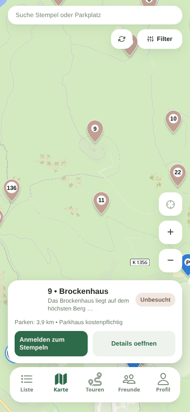
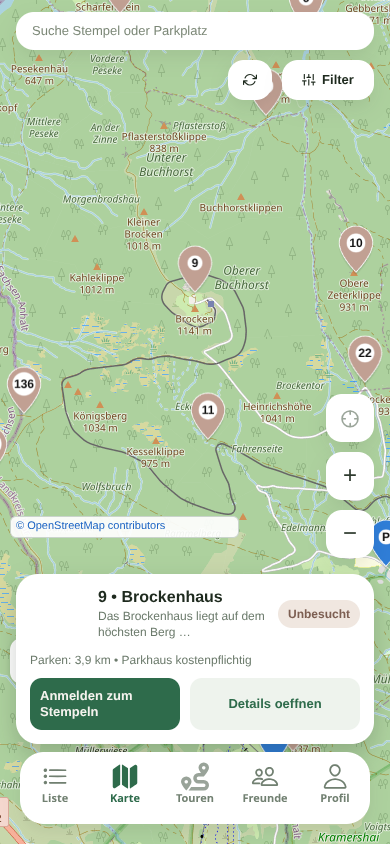
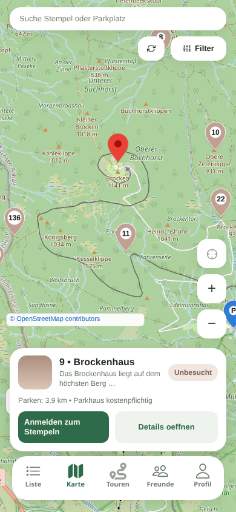
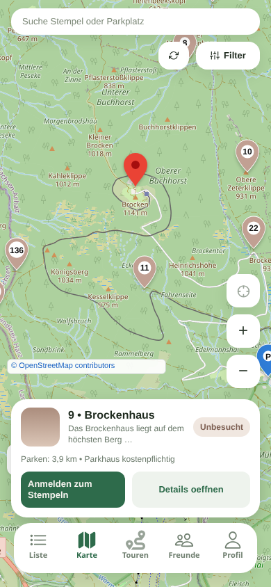

# Marker-Auswahl: fehlende Hervorhebung

Verglichen am 26.10.2026: `develop` bei `b8a663c3a94e59737805f533b924b8a5473b668b` und der mit diesem Stand integrierte Performance-Branch bei `e77687c67b22a1c1275ff81e08beaff12a889664`.

**Befund:** Eine dauerhafte visuelle Hervorhebung des ausgewählten Stempels fehlt bereits auf `develop`. Der Performance-Umbau hat diesen Zustand nicht eingeführt. Gemäß Aufgabenabgrenzung wird die Auswahlgestaltung separat behoben.

## Reproduktion und Ursache

1. Echte statische Expo-App mit dem öffentlichen Katalog öffnen, mobile Ansicht 390 × 844 / DPR 3.
2. Stempel 9 auswählen. Das Detailblatt „9 • Brockenhaus“ öffnet sich und die Karte zentriert/zoomt auf den Stempel.
3. Der Pin behält seine Darstellung. Das gilt vor und nach dem Canvas-Umbau; erneutes Antippen des nun zentrierten Touch-Ziels funktioniert auf beiden Ständen.

In `app/app/(tabs)/map.tsx` setzt `handleMarkerPress` die `selectedItemId`. Die memoisierten `stampMarkerElements` hängen jedoch nicht von dieser ID ab. Ihre Farbe, Größe und Ebene werden ausschließlich aus dem fachlichen Markerzustand bestimmt. Auch `Marker` in `app/components/maps/map-primitives.web.tsx` erhält keinen Auswahlzustand. Im bisherigen DOM-Renderer gibt es keine CSS-Regel für einen ausgewählten Pin. Der neue Canvas-Renderer erhält dieselben unveränderten visuellen Angaben.

Der Browservergleich prüfte vor/nach Auswahl jeweils unveränderte Icon-Kindelemente, Klassen und Markerfarbe; Detailblatt und Touch-Auswahl funktionierten auf beiden Builds ohne JavaScript-Fehler. Im Performance-Build zusätzlich: 222 Stempel nach jedem Stilwechsel sowie Auswahl eines anderen Stempels per Enter. Das ist eine Prüfung des Web-Auswahlzustands; native Android-/iOS-Auswahl wurde nicht getestet.

## Ansatz für die separate Behebung

Den Auswahlzustand explizit vom Bildschirm an beide Marker-Renderer übergeben und bei Auswahlwechsel ausschließlich den vorherigen und den neuen Pin aktualisieren. Hervorhebung und höhere Zeichen-/Trefferebene gemeinsam behandeln. Beim Schließen des Detailblatts muss die Hervorhebung entfallen. Browserfokus und dauerhaft ausgewählter Stempel sind dabei verschiedene Zustände.

## Behebung (28.10.2026)

Die Web-Karte übergibt die Auswahl nun explizit an Canvas- und DOM-Marker.
Der ausgewählte Stempel oder Parkplatz wird als roter GPS-Pin mit dunklem
Mittelpunkt dargestellt, entsprechend den Maps-/Komoot-Referenzen. Er liegt
auf einer höheren Zeichen- und Trefferebene. Die normale Statusdarstellung
und Nummer werden während der Auswahl durch diesen Pin ersetzt.
Beim Wechsel kehrt der vorherige Pin zur normalen Darstellung zurück; beim
Schließen des Detailblatts verschwindet die Hervorhebung. `aria-pressed`
kommuniziert die Auswahl unabhängig vom Tastaturfokus.

Die memoisierten Basis-Elemente bleiben erhalten. Nur das ausgewählte Element
wird mit dem Auswahlzustand ergänzt, sodass bei einem reinen Auswahlwechsel
nur der vorherige und der neue Marker neu rendern. Der Canvas zeichnet seine
komponierte Ebene neu, nutzt dabei aber weiterhin die gecachten Sprites.
Native Android-/iOS-Marker sind von dieser Web-Behebung nicht betroffen.

Geprüft mit 36 Tests in sechs Karten-Testsuites, TypeScript und gezieltem ESLint.
Zusätzlich echter statischer Expo-Export und Playwright/Chromium bei 390 × 844,
DPR 3 mit allen 222 öffentlichen Stempeln: roter GPS-Pin in beiden Renderern,
Auswahlwechsel per Enter, separater Browserfokus, Schließen durch Antippen der
Karte und erhaltene Stempel-DOM-Knoten; keine JavaScript-Fehler.

