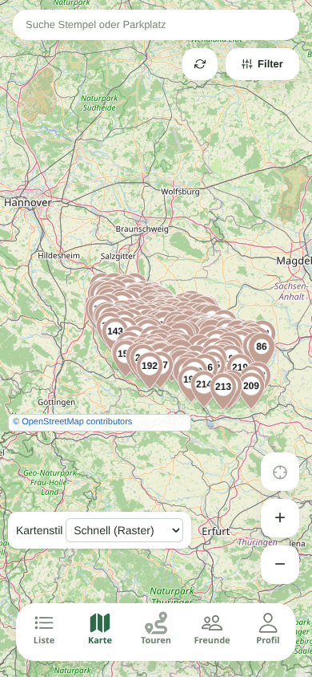
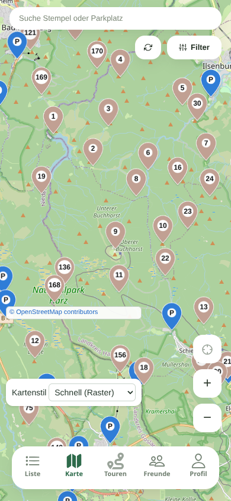

# Mobile Swipe-Messung – gemeinsame Markerdarstellung

App-Messstand: `d8929049af9f4fa4ace7000452e6c53d1028d537`, 25.10.2026.

Alle 222 Stempel werden auf einem gepufferten Canvas gezeichnet. Separate transparente Leaflet-Ziele erhalten Koordinaten, Titel, Touch-Auswahl, Fokus und Enter-/Leertastenbedienung. Es werden weder geografische Cluster gebildet noch Stempel entfernt. Die Pins werden als kleine Sprites einmal gezeichnet und wiederverwendet. Bei Swipes wird die gemeinsame Fläche verschoben; neu gezeichnet wird nur bei Daten-/Zoomänderungen oder beim Erreichen des Pufferrandes. Der alte DOM-Renderer bleibt als Diagnose/Fallback verfügbar.

## Aufbau

- Chromium 145 (Playwright Chromium 1208), Linux, Softwaregrafik; **kein echtes Brave-Android-Gerät**. Brave-Lags des Nutzers sind damit nicht vollständig reproduziert.
- 390 × 844 CSS-Pixel, DPR 3, CPU vierfach gedrosselt. Hardware-GPU eines Handys wird dadurch nicht simuliert.
- Drei Wiederholungen mit je acht Touch-Swipes bei **3.500 CSS-Pixeln/s**, einschließlich möglichem Nachlauf (`preventFling: false`). Insgesamt 144 Swipes über beide Renderer und drei Zoomstufen.
- Identischer Build; `markerRenderer=dom` stellt die bisherige DOM-Grafik als Vergleich her, der Standard verwendet den Canvas. Abwechselnde Reihenfolge der Renderer je Wiederholung.
- Zoom 2 = maximale Übersicht, Zoom 8 = Harz-Übersicht, Zoom 12 = Parkplatzstufe. Auf Zoom 12 sind beim Start tatsächlich 28 Parkplatzmarker und weiterhin 222 Stempel vorhanden. Gleicher Mittelpunkt beim Brocken.
- Kacheln werden nur auf tatsächliche Browseranfragen geladen und für die Messreihe im Arbeitsspeicher wiederverwendet. Die Werte messen warme Interaktion, nicht den Download über Mobilfunk.
- Ausgewertet werden rAF-Bildabstände, Long Tasks, Chrome-Trace-`EventLatency` für Touch-Bewegung und Touch-Ende sowie `LayerTree.drawsContent`. Zeichen-Layer können auch außerhalb des sichtbaren Ausschnitts liegen; die Zahl ist kein FPS-Wert.

## Ergebnisse

| Renderer | Zoom | Touch-Bewegung p95 | Touch-Ende p95 | längster Bildabstand | Zeichen-Layer, Median |
|---|---:|---:|---:|---:|---:|
| bisheriger DOM | 2 | 17.5 ms | 7.6 ms | 16.8 ms | 232 |
| bisheriger DOM | 8 | 17.5 ms | 9.6 ms | 50.0 ms | 238 |
| bisheriger DOM | 12 | 17.5 ms | 10.9 ms | 100.0 ms | 262 |
| gemeinsamer Canvas | 2 | 17.4 ms | 7.5 ms | 16.8 ms | 11 |
| gemeinsamer Canvas | 8 | 17.5 ms | 9.2 ms | 16.8 ms | 17 |
| gemeinsamer Canvas | 12 | 17.7 ms | 19.1 ms | 50.0 ms | 13 |

Die Touch-Bewegungen liegen mit der neuen Darstellung in allen drei Zoomstufen bei rund 17–18 ms (p95). Die herausgezoomten Stufen erreichen damit in dieser Messung das Niveau der Parkplatzstufe. In der Harz-Übersicht sinken die Zeichen-Layer von 238 auf 17 (rund 93 % weniger). Der längste beobachtete Bildabstand fällt dort von 50 auf 16,8 ms. Beim Weltzoom waren die warmen Bildabstände schon vorher gleichmäßig; ein pauschaler FPS-Gewinn ist daraus **nicht** ableitbar. Auch der höhere Touch-Ende-p95-Wert auf Parkplatzzoom beim Canvas wird in der Tabelle nicht ausgeblendet.

Der wesentliche Gewinn ist die stark verringerte Zahl separater grafischer Flächen, Masken und Live-Schatten. Das adressiert schwächere Handy-Compositoren. Eine Garantie für das konkrete Brave-Handy ist diese Softwaregrafik-Messung nicht.

[CSV mit zusätzlichen Maximalwerten und Blockierzeit](measurements/mobile-swipe-20261025.csv)

## Wiederholen

Der Browser benötigt den paketierten öffentlichen Vorschau-Build mit dem statischen `mapPerf`-Diagnosezugang. Der Zugang wird nur im statischen Gastprofil und nur bei explizitem Query aktiviert. Keine Anmeldung oder Sitzung exportieren. Python Playwright und ein passender Chromium müssen bereits verfügbar sein.

```bash
python scripts/measure-web-map-swipes.py \
  --site-root <paketiertes-dist> \
  --catalogue <public-catalogue.json> \
  --output <neuer-messordner> \
  --browser-executable <chromium>
```

Der neue Messordner enthält Einzelmessungen, Roh-Traces für beide Übersichtsvarianten, CSV, JSON-Zusammenfassung und Screenshots. Nicht mit gleichzeitig laufenden Builds oder anderen Browserprüfungen messen.

## Funktionsprüfung

Geprüft wurden die Nummern 1–222 genau einmal, ihre erhaltenen DOM-Ziele bei Zoom 2/8/12 und Stilwechseln, 222 Canvas-Einträge beziehungsweise 250 mit den Parkplätzen, Touch-Auswahl von Stempel 9 und Tastaturauswahl von Stempel 1. Symbolschriften werden geladen; keine JavaScript-Fehler und keine separaten Katalog-/Schriftanfragen. Beim Weltzoom wird die Canvas-Größe nach Web-Mercator-Projektion bestimmt, damit der Pin-Atlas nicht gestreckt wird. Ohne Canvas-2D/Path2D fällt die Darstellung auf die bisherigen Einzelgrafiken zurück.




