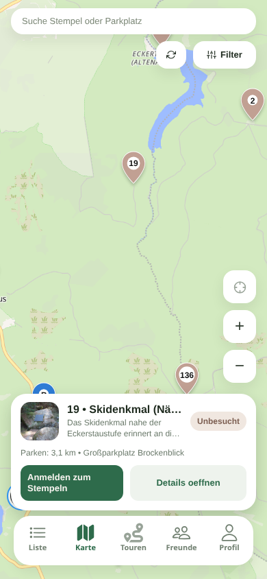

# Mobile Web-Karte: Renderkosten reduzieren

Analyse der Vorschau `/preview/overview/app/map`, 24.10.2026.

## Befund und Änderung

Die ausgelieferte Karte verwendet bereits CSS-Div-Marker; im mobilen
Startausschnitt sind alle 222 regulären Stempel als einzelne Marker vorhanden.
Der Hintergrund wird dagegen von MapLibre GL innerhalb von Leaflet gerendert.
Der Liberty-Stil enthält 111 Layer und benötigt zusätzlich Stil, Tile-Metadaten,
Vektorkacheln, Sprites und Schriftdateien. Die längsten beobachteten
Netzwerkanfragen lagen unter 0,5 Sekunden. Im CPU-Sampling liegt die meiste
zuordenbare JavaScript-Arbeit im MapLibre-Modul; zusätzlich entstehen lange
Aufgaben beim Grafikaufbau.

Bei 390 × 844 CSS-Pixeln und `deviceScaleFactor: 3` erzeugt der bisherige
Renderer einschließlich Leaflet-MapLibre-Puffer ein Canvas mit 1404 × 3039
Pixeln. Die neue Obergrenze `pixelRatio: 1.5` reduziert es auf 702 × 1519:
von 4.266.756 auf 1.066.338 Pixel, rund **75 % weniger Zeichenfläche**.
Bildschirme mit DPR 1 bleiben unverändert. Nur der Hintergrund wird mit
geringerer Auflösung gezeichnet; DOM-Stempel, Zahlen und Bedienelemente behalten
die Bildschirmauflösung. Kartenschrift kann auf hochauflösenden Geräten etwas
weicher aussehen. `fadeDuration: 0` vermeidet zusätzliche MapLibre-Frames für
Beschriftungsübergänge; Leaflets Karten- und Markerzoom bleiben animiert.

Stempel bleiben nun unabhängig vom Viewport montiert. `visibleStampItems`
bleibt bei reinen Regionsänderungen referenzstabil, sodass auch die memoisierten
Marker-Elemente erhalten bleiben. Die 222 Stempel werden weder geclustert noch
beim Zoomen entfernt. Fachliche Stempelfilter gelten weiterhin. Die bestehende
Viewportbegrenzung für Parkplätze bleibt erhalten.

## Prüfung

- Echter statischer Expo-Export mit `scripts/build-static-website.mjs`.
- 35 Tests in fünf Karten-Testsuites sowie gezieltes ESLint und `git diff --check`.
- Playwright/Chromium bei 390 × 844 und DPR 3: Canvasgröße und 222 Marker prüfen;
  zoomen, verschieben und einen Marker auswählen. Identität der Marker-DOM-Knoten
  nach Zoom und Verschieben prüfen, nicht nur deren Anzahl.
- A/B auf derselben ausgelieferten JavaScript-Datei mit ausschließlich geänderten
  MapLibre-Optionen. Die Canvas-Reduktion ist in allen drei Paaren identisch.
  Long-Task-Zeiten schwanken deutlich; zwei Paare wurden durch einen parallel
  laufenden Export beeinflusst. Deshalb keine allgemeine Ladezeit- oder
  FPS-Prozentverbesserung daraus ableiten. Im letzten Paar ohne Export sank die
  längste Aufgabe von 467 auf 234 ms. Chromium verwendet hier Software-WebGL;
  ein echter Handyvergleich bleibt für belastbare FPS-Aussagen erforderlich.

Screenshot des exportierten Builds:

