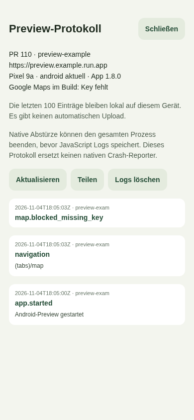

# Preview-Diagnose und Android-Kartenabsturz

## Befund vom 04.11.2026

Auf einem Pixel 9a schließt sich die installierte Preview direkt beim Öffnen des
Karten-Tabs; Anmeldung und Liste funktionieren. In den Android-Build-Logs des
Runs `41873461391` für Commit `c9652dc` ist `EXPO_PUBLIC_GOOGLE_MAPS_API_KEY` leer.
Die damalige Konfiguration verlangt den Key nur für Android-EAS-Builds, während
dieser Workflow direkt mit Gradle baut. Die Karte wurde trotzdem nativ erzeugt.

Ein entsprechender Prebuild ohne Key enthält kein
`com.google.android.geo.API_KEY` im Android-Manifest. Genau dieser Fall kann im
nativen Google-Maps-SDK eine unbehandelte `IllegalStateException: API key not
found` auslösen und den gesamten App-Prozess beenden. Das ist die stärkste
gefundene Erklärung für das unmittelbare Schließen beim Tab-Wechsel. Der konkrete
Stacktrace des physischen Pixels liegt nicht vor; andere native Ursachen sind
damit noch nicht vollständig ausgeschlossen.

Die 222 Stempelstellen und 211 Parkplätze der Dummy-CSV-Dateien enthalten keine
fehlenden, nicht endlichen oder außerhalb der gültigen Breiten-/Längengrade
liegenden Koordinaten. Die Standort-Hooks prüfen beim Einstieg nur eine vorhandene
Berechtigung und behandeln Fehler; die Abfrage einer neuen Freigabe erfolgt erst
auf ausdrücklichen Standort-Aufruf.

Siehe den [Fehlerbericht mit nativem Stacktrace im Maps-Projekt](https://github.com/react-native-maps/react-native-maps/issues/5884).

## Kartenkonfiguration reparieren

1. Im zuständigen GCP-Projekt **Maps SDK for Android** aktivieren und einen
   Android-Maps-Key anlegen bzw. den vorhandenen verwenden.
2. Den Key auf diese API und den Preview-Paketnamen beschränken:
   `de.kuestenbit.harzerwanderbuddy.preview.pr110` für PR #110. Dazu den SHA-1-
   Fingerprint des **Preview-Keystores** eintragen, nicht den Produktions- oder
   lokalen Debug-Schlüssel. Den Fingerprint zeigt `keytool -list -v` für den
   bei der Einrichtung gesicherten Preview-Keystore oder `apksigner verify
   --print-certs preview.apk` für die heruntergeladene APK.
3. In GitHub unter **Settings → Environments → pr-preview → Environment secrets**
   den Key als **`PREVIEW_GOOGLE_MAPS_API_KEY`** setzen. Der Workflow übergibt ihn
   beim Build als `EXPO_PUBLIC_GOOGLE_MAPS_API_KEY`.
   Alternativ wird eine Environment-Variable gleichen Namens unterstützt; ein
   vorhandenes Secret hat Vorrang. Die Unterscheidung ist wichtig: Frühere
   Workflow-Versionen lasen ausschließlich `secrets.*`, sodass ein Eintrag unter
   **Variables** trotz korrektem Namen nicht im APK ankam.
4. Die Preview erneut bauen und die neue APK installieren. Eine Einstellung am
   Cloud-Run-Backend kann den fehlenden Key im bereits installierten APK nicht
   nachträglich ersetzen. Preview-OTAs sind deaktiviert.

Der Build prüft nun die native Manifest-Metadaten und schreibt nur deren
Vorhandensein in `build-diagnostics.json`. Der Key selbst wird dort nicht gespeichert.
Ohne Key bleibt der Build möglich, aber die Android-Preview rendert einen Hinweis
statt einer nativen MapView. Damit lässt sich der Rest der App weiter testen.
Eine vorhandene Metadaten-Zeile beweist noch nicht, dass API-Aktivierung und
Paket-/Signatur-Beschränkungen bei Google korrekt konfiguriert sind.

## Lokales Protokoll in der Preview

**Profil → Technische Details → Preview-Protokoll** zeigt:

- PR, Commit, Backend, App-Version, Android-Version und Gerätemodell;
- ob der Android-Maps-Key beim Build konfiguriert war;
- Start/Lebenszyklus, Navigation über Routenvorlagen und Kartenaufruf/-Bereitschaft;
- endgültig fehlgeschlagene Query-/Mutation-Aufrufe ohne Variablen oder vollständige
  Query-Keys sowie erfasste JavaScript-/React-Fehler.

Die letzten 100 Einträge bleiben lokal in AsyncStorage erhalten, auch nach einem
normalen Neustart. „Aktualisieren“, „Teilen“ und „Logs löschen“ steuern das
Protokoll. Es gibt keinen automatischen Upload. Übliche Token-/Passwort-Felder,
Authorization-Werte, Maps-Key-Muster, URL-Abfragen und E-Mail-Adressen werden
gefiltert. Es wird keine allgemeine Aufzeichnung sämtlicher Konsolenmeldungen,
HTTP-Header, Request-Bodies oder Zugangsdaten eingerichtet.

Die Funktion wird nur für Builds mit Preview-Metadaten aktiviert. Normale Builds
erhalten weder den Diagnose-Button noch persistente Preview-Logs.

## Was damit bei Abstürzen möglich ist

JavaScript-Fehler und React-Renderfehler können protokolliert werden. Der
bisherige globale Fehlerhandler bleibt aktiv; Fehler werden nicht verschluckt.
Bei einem fatalen Fehler ist die asynchrone Speicherung nur ein Best-Effort-Versuch.

Ein nativer Java-/Kotlin-Absturz, ein SIGSEGV oder ein vom Betriebssystem wegen
Speichermangels beendeter Prozess kann JavaScript und AsyncStorage sofort stoppen.
Ein React Error Boundary verhindert solche nativen Abstürze nicht. Die letzten
gespeicherten Ereignisse helfen bei der Einordnung, ersetzen aber keinen nativen
Stacktrace. Für automatische native Crash-Berichte wären beispielsweise Sentry
oder Firebase Crashlytics mit eigener Einrichtung und nativer SDK-Integration
sinnvoll; diese Integration ist hier nicht enthalten.

Für einen konkreten Android-Absturz kann ein per USB autorisierter Rechner
Android-Logcat aufzeichnen. App zunächst auf der funktionierenden Liste öffnen,
dann im Terminal starten und anschließend am Gerät auf die Karte tippen:

```bash
adb devices
preview_pid=$(adb shell pidof -s de.kuestenbit.harzerwanderbuddy.preview.pr110)
test -n "$preview_pid"
adb logcat --pid="$preview_pid" -b main -b system -b crash -v threadtime > hwb-preview-crash.txt
# Nach dem Absturz mit Strg+C beenden.
```

Wichtig sind `FATAL EXCEPTION`, `AndroidRuntime`, `API key not found` oder
`Fatal signal`. Das Log vor dem Weitergeben auf persönliche Daten prüfen. Dafür
sind weder Root-Rechte noch Expo Go nötig.

Das APK-Artefakt enthält zusätzlich `build-diagnostics.json` und, wenn Gradle sie
erzeugt, `index.android.bundle.map`. Die Source Map hilft bei minifizierten
JavaScript-Stacktraces derselben APK; sie ersetzt keine nativen Debug-Symbole.

## Prüfung und Grenzen

Gezielte Tests prüfen Preview-Metadaten, das Verhindern der nativen Karteninstanz
ohne Key, Log-Persistenz und Begrenzung, Redaktion, Erhalt des Fehlerhandlers sowie
Anzeigen/Teilen/Löschen des Protokolls. Ein isolierter Android-Prebuild ohne Key
bestätigt fehlende Maps-Metadaten, Preview-Paketnamen und deaktivierte OTA-Updates.

Die Screenshots zeigen die tatsächlichen neuen Komponenten in einer isolierten
Webvorschau mit Testeinträgen. Sie sind **keine Geräteabnahme** und enthalten keine
Nutzerdaten. Der Absturz wurde auf dem physischen Pixel nicht mit Logcat reproduziert.

23 gezielte Tests sowie ESLint, Workflow-Lint und Shell-Syntax wurden lokal
geprüft. Die vollständige lokale Testsuite bleibt durch den bereits zuvor
unvollständigen Dependency-Cache begrenzt: 235 Tests bestehen, fünf Suites laden
wegen des fehlenden `react-native-svg/filter-image` nicht. Auch TypeScript meldet
lokal nur diesen fehlenden Import in zwei bestehenden Dateien. Vorhandene
Abhängigkeiten und native Build-Caches wurden nicht ersetzt oder gelöscht.




