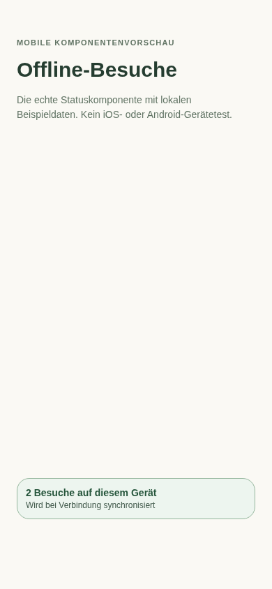
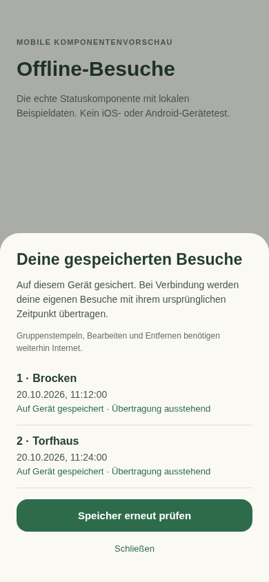
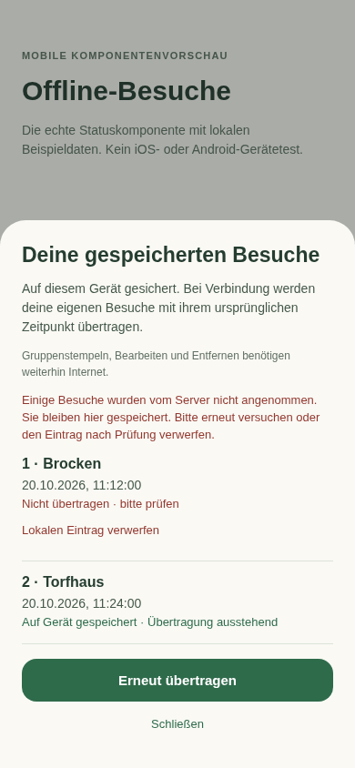

# Offline-Erfassung: Screenshots und Umfang

Stand: 20.10.2026. Eigenständiger Feature-PR, abgezweigt von `develop`.

## Verhalten auf iOS und Android

Eigene neue Besuche lassen sich in Liste/Mehrfachauswahl, Karte und Stempeldetails
auch ohne Verbindung erfassen. Vor einer Erfolgsmeldung wird der Besuch mit einer
stabilen UUID und dem ursprünglichen Zeitpunkt in AsyncStorage gespeichert. Die
Warteschlange ist unabhängig vom zeitlich begrenzten Query-Cache und getrennt nach
Backend und Konto. Sie enthält keine Zugangsdaten. Ein Lesefehler überschreibt
vorhandene Warteschlangen nicht; ein Schreibfehler meldet keinen Speichererfolg.

Liste, Karte, eigenes Profil, Besuchshistorie und Stempeldetails zeigen lokale
Besuche als Ergänzung zu unveränderten Server-/Cache-Daten. Ortsfortschritt zählt
jede Stelle einmal; absichtliche Wiederholungsbesuche bleiben einzelne Besuche.
Unbestätigte Besuche lassen sich noch nicht serverseitig bearbeiten/löschen.

Die Übertragung läuft beim Start mit Verbindung, bei Wiederverbindung, bei Rückkehr
in den Vordergrund und alle 30 Sekunden während der nutzbaren Sitzung. Ein Token
wird erst für die Übertragung geholt. Ohne Anmeldung/Verbindung verbleibt der
Besuch lokal. Bei Kontowechsel wird ausschließlich die Warteschlange des aktuellen
Kontos angezeigt und übertragen; ausstehende Besuche bleiben für erneute Anmeldung
unter ihrem ursprünglichen Konto erhalten. Keine garantierte Hintergrundübertragung
bei geschlossener App.

Jeder Wiederholungsversuch verwendet dieselbe UUID und denselben Besuchszeitpunkt.
Der bestehende CAP-Endpunkt akzeptiert diese Werte bereits. Ein Duplicate-Fehler
(bei SQLite 400, sonst gegebenenfalls 409) wird nur dann als Erfolg behandelt,
wenn ein anschließender Abruf genau dieselbe Kennung, denselben Besitzer, dieselbe
Stempelstelle und denselben Zeitpunkt bestätigt. Einträge verschwinden erst nach
Bestätigung und dauerhaft gespeicherter Quittierung. Abgelehnte Besuche bleiben
mit Prüfhinweis erhalten; erneutes Übertragen und bewusstes Verwerfen sind möglich.

Gruppenstempeln, Notizen, Datumsänderungen und Löschen bleiben online. Die Web-App
erhält keine Offline-Schreibfunktion. Es werden keine Offline-Karten eingeführt.
AsyncStorage übersteht normale Neustarts, ist aber kein Backup gegen Deinstallation,
Geräteverlust oder manuelles Löschen der App-Daten. Ausstehende Besuche deshalb vor
solchen Aktionen übertragen. Für die native Abhängigkeit `expo-crypto` einen
kompatiblen nativen Build verwenden; keine manuelle Versionsnummer geändert.

## Aufnahmen

**Diese Bilder sind Browser-Renderings der echten produktiven React-Native-
Statuskomponente mit React Native Web, 390 × 844 Pixel, und festen Beispieldaten.**
Es sind keine iOS-/Android-Emulatoraufnahmen und kein Beleg für native
Geräte-/Flugmodusabnahme. `preview.tsx` stellt ausschließlich diese Komponente dar;
es gibt keinen zusätzlichen Preview-Screen in der App. Konten, Stempel und Zeiten
sind lokale Testdaten, keine Produktionsdaten.

| Zustand | Aufnahme |
| --- | --- |
| Lokal gespeichert, Übertragung ausstehend |  |
| Besuchsliste mit ursprünglichen Zeitpunkten |  |
| Serverablehnung mit Wiederholen/Verwerfen |  |

Reproduktion vom Repository-Root, nach `npm ci --prefix app`:

```bash
npm install --prefix /tmp/hwb-offline-preview esbuild playwright
OFFLINE_PREVIEW_TOOLS=/tmp/hwb-offline-preview CHROMIUM_PATH=/usr/bin/chromium \
  node docs/screenshots/native-offline-visits/capture.cjs
```

`CHROMIUM_PATH` an eine vorhandene Chromium-Installation anpassen oder mit einem
von Playwright installierten Browser weglassen. Hilfspakete bleiben außerhalb der
App-Abhängigkeiten. Aufnahme startet nur einen lokalen HTTP-Server.

## Prüfung

- Jest: Persistenz/Neustart, Speicherfehler, verlorene Serverantwort, parallele
  Einträge, Dubletten, Wiederholungsbesuche, Konto-/Logouttrennung, Web-Ausschluss,
  Wiederverbindung, Ablehnung, UI-Meldungen und native Mehrfachauswahl.
- Backend-Integration mit In-Memory-Datenbank: stabile ID, ursprüngliche Zeit,
  authentifizierter Besitzer, Replay und absichtlicher zweiter Besuch.
- TypeScript und ESLint für geänderte Implementierung.
- Noch auf echten Geräten prüfen: Flugmodus mit anschließendem Kaltstart,
  abgelaufene Anmeldung, OS-Speicherdruck und Wiederverbindung nach längerer Pause.
