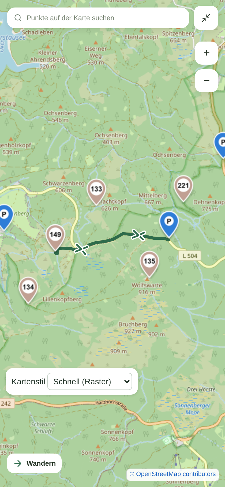
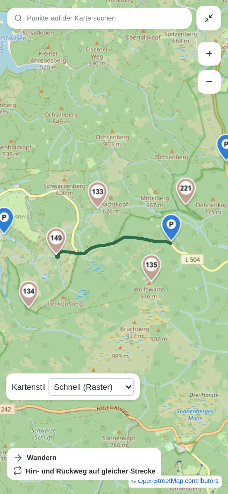

# Gemeinsamer Hin- und Rückweg

Vorher-/Nachher-Aufnahmen der echten Expo-Web-App, mobile Vollbildkarte bei
390 × 844 CSS-Pixeln und DPR 2. Beide Aufnahmen verwenden denselben Kartenausschnitt
und dieselbe ausschließlich lokal angelegte Tour „Runde bei Kleine Oker“:
Parkplatz 133, 135, 221 Rundweg → Stempel 149 (Kleine Oker) → derselbe Parkplatz.
Die beiden gespeicherten OData-Etappen verlaufen auf derselben Strecke.

| Vorher | Nachher |
| --- | --- |
|  |  |

Vorher: Touransicht aus `7b7b931`. Nachher: Änderung dieses PRs. Kartenstil,
Geometrie, Pin-Darstellung und Tourdaten sind in beiden Aufnahmen gleich.

Gemeinsam in Gegenrichtung genutzte Abschnitte erhalten keine Richtungspfeile.
Die Legende ergänzt „Hin- und Rückweg auf gleicher Strecke“. Pfeile auf den übrigen
Abschnitten bleiben erhalten. Die Erkennung verwendet eine Toleranz von drei Metern,
nahezu entgegengesetzte Richtungen und eine Mindestüberlappung; sie ist vom Zoom
unabhängig und berücksichtigt unterschiedlich dicht abgetastete Geometrien.

Validiert: vollständiger Rückweg, teilweise gemeinsame Strecke, Rückweg innerhalb
einer einzelnen Etappe, unterschiedliche Abtastung, kleine Koordinatenabweichungen,
getrennte parallele Wege, Kreuzungen, normale Rundtouren und beide Verkehrsmittel.
35 gezielte Jest-Tests, TypeScript, ESLint und `git diff --check` erfolgreich.
Die Screenshots sind Web-Aufnahmen. Eine native Android-Sichtprüfung wurde für
diesen PR nicht durchgeführt; die Geometrieaufbereitung wird von beiden Plattformen verwendet.
