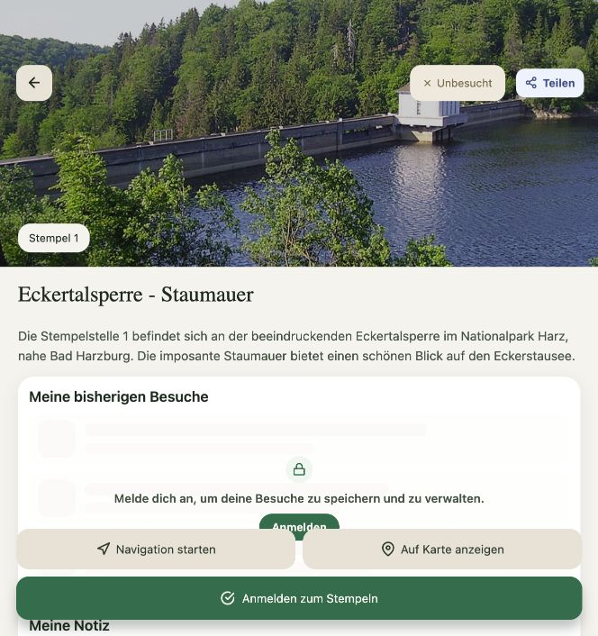
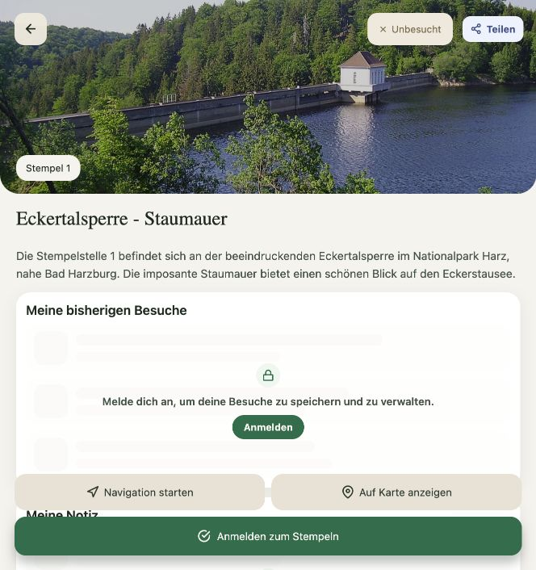

# Elastischer Header der Stempel-Detailansicht

Aufgenommen am 14.10.2026 in der lokalen Web-App mit der Eckertalsperre (Stempel 1), im Gastmodus. Die Screenshots zeigen dieselbe Ansicht bei 664 × 706 Pixeln.

| Normalzustand | Während der Ziehgeste | Nach dem Loslassen |
| --- | --- | --- |
|  |  |  |

Die mittlere Aufnahme entstand während einer echten Maus-Ziehgeste im Browser. Das Bild wächst proportional, die Bedienelemente behalten ihre Größe, und der Inhalt kehrt nach dem Loslassen in seine Ausgangsposition zurück. Eine kurze Ziehgeste öffnet die Galerie nicht; ein anschließender Klick auf das Bild öffnet sie weiterhin. Native iOS- und Android-Ansichten wurden hier nicht aufgenommen.
