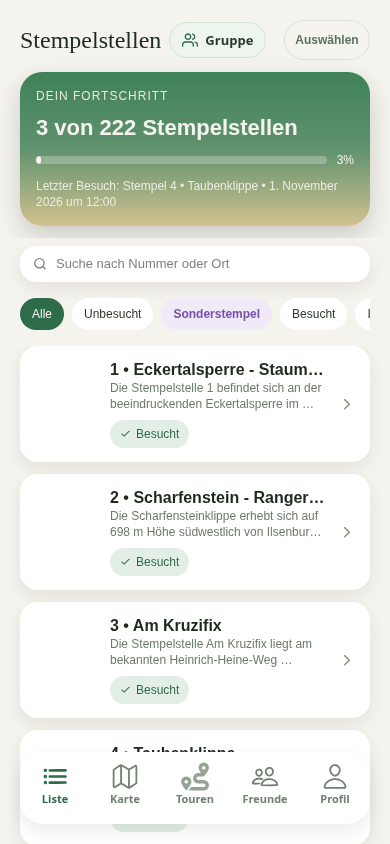
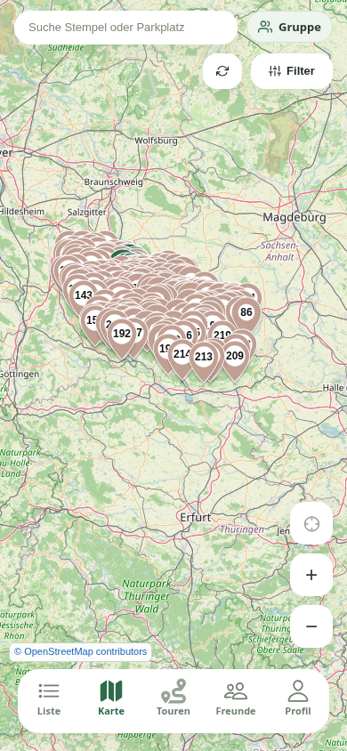
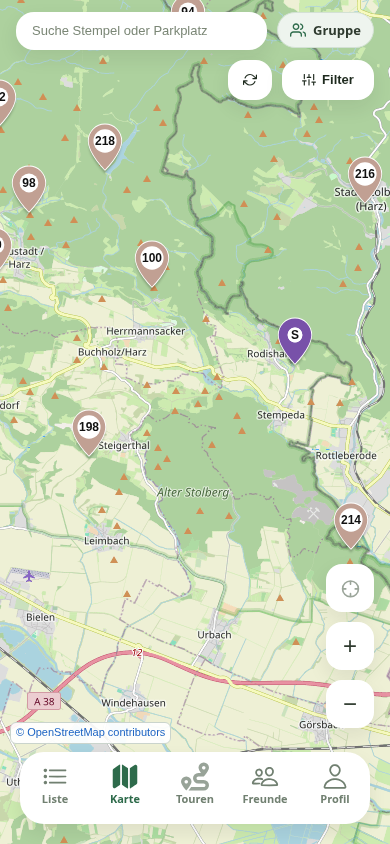
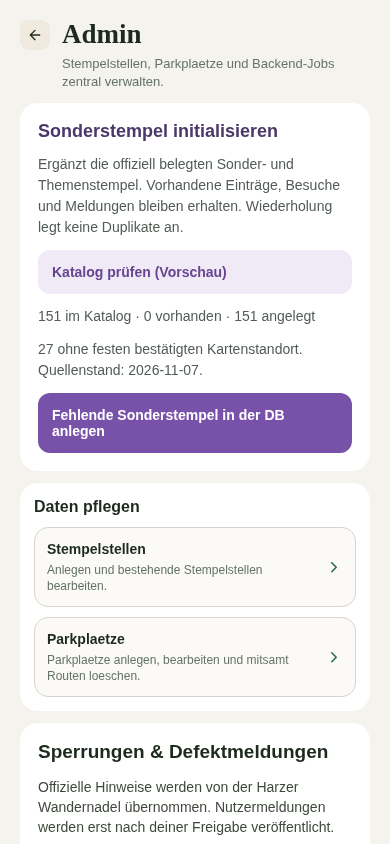
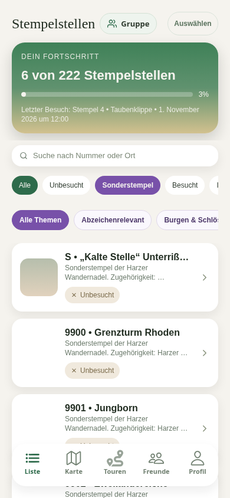
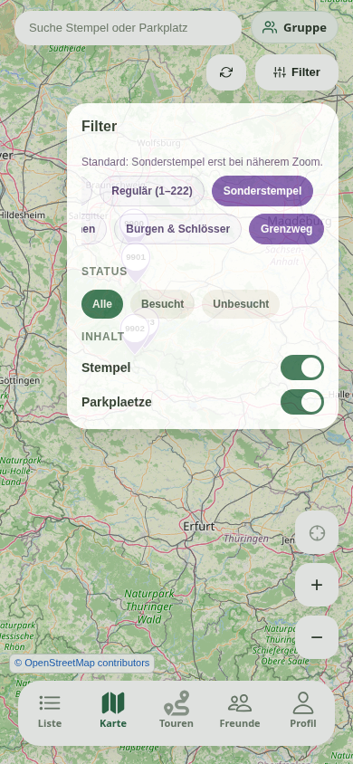
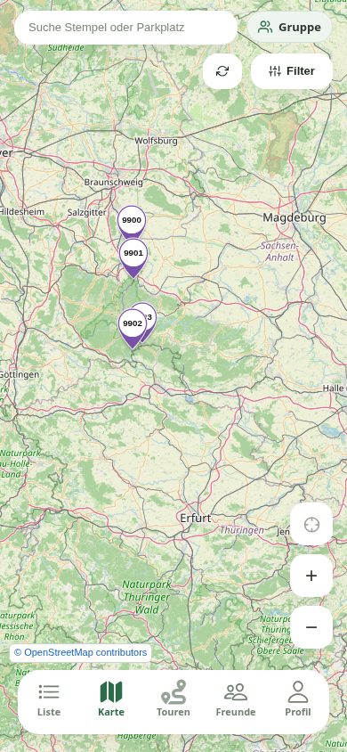
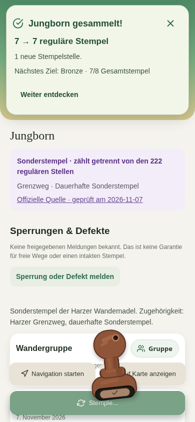
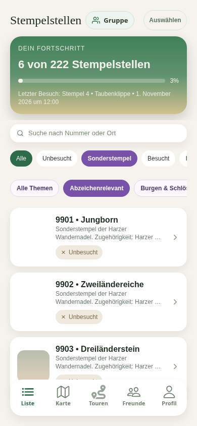

# Sonder- und Themenstempel

Der Katalog ergänzt die 222 regulären HWN-Stempelstellen um **151 belegte Sonder- und Themenstempel** (Quellenprüfung: 7. November 2026). Alle 151 stehen in der Entwicklungs-CSV und können über eine ausdrücklich gestartete Admin-Aktion in eine bestehende Datenbank übernommen werden. Es gibt keinen automatischen Produktivimport.

## Quellen und Abdeckung

Die versionierte Quelle ist `backend/hwb/catalogue/special-stamps.json`. Die sachlichen Tabellenwerte der sieben Themenquellen liegen zusätzlich in `special-stamp-source-tables.json`. Beschreibungen sind knapp aus diesen Fakten formuliert; Bilder und längere Originaltexte werden nicht übernommen.

- [Dauerhafte Sonderstempel einschließlich Grenzweg und mobiler Zugstempel](https://www.harzer-wandernadel.de/stempelstellen/sonderstempel/)
- [Lutherweg](https://www.harzer-wandernadel.de/stempelstellen/lutherweg/)
- [Karstwanderweg](https://www.harzer-wandernadel.de/stempelstellen/karstwanderweg/)
- [Geschichtsorte – Burgen und Schlösser](https://www.harzer-wandernadel.de/stempelstellen/harzer-geschichtsorte-burgen-und-schloesser/)
- [Huy-Fallstein](https://www.harzer-wandernadel.de/stempelstellen/huy-fallstein/)
- [Talsperren im Harz](https://www.harzer-wandernadel.de/stempelstellen/talsperren-im-harz/)
- [Jubiläumsheft 2026](https://www.harzer-wandernadel.de/jubilaeumsheft-2026/)
- [Klosterwanderweg](https://www.harzer-wandernadel.de/stempelstellen/klosterwanderwerg/)
- [Aktuelle Defektmeldungen und Standortinformationen](https://www.harzer-wandernadel.de/defektmeldungen/)

Alle Sonderstempel-Einträge der genannten Sonderstempelseite und Thementabellen sind berücksichtigt. Ausdrücklich als reguläre HWN-Nummer gekennzeichnete Tabellenzeilen verweisen auf die bestehenden regulären Stellen und erzeugen keine Sonderstempel-Duplikate. Geprüfte gemeinsame Identitäten mehrerer Themen, etwa Grenzturm Rhoden, werden einmal angelegt und tragen mehrere Themenzugehörigkeiten. Räumliche Nähe allein ist keine Zusammenführungsregel.

Der Katalog behauptet keine Vollständigkeit für sämtliche historischen Hefte, Veranstaltungen oder künftig hinzukommenden Sonderstempel. Für Quedlinburg wird die aktuell gemeldete Aholzwarte aufgenommen; eine vollständige zusätzliche Quedlinburger Heftliste wurde durch diese Quellen nicht belegt.

**124 Einträge haben belegte Kartenkoordinaten.** Die übrigen 27 werden ebenfalls angelegt: zwei mobile Zugstempel und 25 Einträge ohne bestätigte Koordinaten. Dazu gehören entfallene Stellen. Sie bekommen weder Nullinsel-Koordinaten noch geschätzte Nachbarstandorte. Karte, Routen-Zielauswahl und Nachbarschaftsberechnung lassen Einträge ohne Koordinaten aus. Der direkte Routenaufruf weist solche Ziele mit HTTP 422 zurück. Liste, Details und Besuchshistorie erhalten diese Einträge.

Der Katalog dokumentiert unterschiedliche Standortstände durch zusätzliche Quellen. Für die ausdrücklich zusammengeführten Jubiläumsstellen verwendet er die Koordinaten der aktuellen Jubiläumsheft-Tabelle. Die fehlerhaft formatierte Koordinatenangabe zum Ahornpark auf der dauerhaften Sonderstempelseite wird nicht geraten; dafür steht die bestätigte Tabellenangabe zur Verfügung.

## Identität, Besuche und Abzeichen

`Stampboxes` bleibt die gemeinsame Entität für reguläre und besondere Stellen. Neue optionale Metadaten: `stampType`, `catalogKey`, `themeKeys` (JSON-Liste), `sourceUrl`, `sourceCheckedAt`, `locationStatus`, `availability` und `identityStatus`. UUIDs werden stabil aus dem fachlichen Schlüssel erzeugt. `catalogKey` ist eindeutig. Die Anzeigenummer ist keine Identität; nicht nummerierte Sonderstellen zeigen `S`.

Besuche, Notizen, Community- und offizielle Meldungen behalten ihre bisherigen UUID-Referenzen. Standortwechsel dürfen weder einen weiteren regulären Fortschrittspunkt erzeugen noch Besuche löschen. Entfallene Stempel bleiben als solche gekennzeichnet. Eine Katalogaufnahme oder ein Wegfall ersetzt keine Änderung der Abzeichenregeln.

Die Umsetzung baut auf PR #65 (`003218d`) und PR #89 (`f6fa0bf`) auf und führt beide lokal zusammen. Sie verändert die vereinbarten Abzeichenbedingungen nicht:

- Reguläre Leistungsabzeichen und der reguläre Fortschritt zählen ausschließlich unterschiedliche Nummern 1–222. Das gilt auch für Liste, Profil und Freundesfortschritt.
- Grenzweg verlangt weiterhin die festgelegten 20 regulären Pflichtstellen sowie `special-two-countries-oak`, `special-jungborn` und `special-three-countries-stone`. Die drei Schlüssel aus PR #65 sind erhalten und besitzen jetzt reale Katalogeinträge.
- Sonstige Sonderstempel erhöhen weder diese drei Pflichtbedingungen noch den regulären Fortschritt. Jeder Sonderstempel besitzt eine eigene Identität, auch wenn seine Anzeigenummer nur `S` lautet.
- Bestehende historische `SX-…`-Schreibweisen der drei Grenzweg-Stellen bleiben über explizite Aliase lesbar; beliebige Namen mit einem passenden Teilwort werden nicht mehr gleichgesetzt.
- Freischaltung und Entzug bleiben serverseitig. Die Erfolgskarte bestätigt Sonderbesuche, ohne den regulären Zähler zu erhöhen. Neue Themen-Abzeichen werden nicht ohne fachliche Regelprüfung erfunden.

## Initialisierung und Entwicklungsdaten

Zuerst die normale CAP-Schemamigration ausführen. `db/init.js` legt zusätzlich den Lock-Datensatz `special-catalog` an. Ohne diesen Datensatz scheitert eine schreibende Initialisierung mit HTTP 503. Die Migration selbst legt keine Sonderstempel an.

Im Adminbereich gibt es **Sonderstempel initialisieren** mit Vorschau und eigenem Button **Fehlende Sonderstempel in der DB anlegen**. Die Aktion `POST /odata/v4/api/initializeSpecialStamps` ist ausschließlich für Admins freigegeben:

```json
{ "preview": true }
```

Nur explizites `false` schreibt. Die Antwort enthält Gesamtzahl, vorhandene/angelegte/fehlende Einträge, Konflikte und die Anzahl ohne festen bestätigten Kartenstandort. Schreibende Aufrufe werden über den Datenbank-Lock serialisiert. Sie fügen nur fehlende Einträge hinzu; vorhandene Namen, Standorte, Besuche, Notizen und Meldungen werden nicht überschrieben. Kollisionen von UUID, offizieller Sondernummer oder exaktem Namen ohne passende Katalogidentität werden zur manuellen Prüfung zurückgegeben. Es gibt keine automatische Übernahme eines ähnlich benannten Altbestands.

Die Entwicklungs-CSV `backend/hwb/db/doNotDeploy-data/hwb.db.Stampboxes.csv` enthält **373 Einträge: 222 reguläre und 151 Sonderstempel**. Reproduzierbar vom Repository-Root:

```sh
node backend/hwb/util/generateSpecialStampFixtures.js
```

Der Generator aktualisiert ausschließlich diese Entwicklungsdaten sowie die abgeleiteten regulären Themenzugehörigkeiten und abzeichenrelevanten Sonderidentitäten der App. Er greift nicht auf eine Datenbank zu. Wiederholung erzeugt byteidentische Ergebnisse. Die bestehenden regulären UUIDs, Standorte und Beschreibungen bleiben erhalten.

Der öffentliche Website-Export überspringt explizite Sonderstempel-Identitäten vor der Prüfung von Anzeigenummer und Koordinaten. Sein öffentliches Schema bleibt auf die 222 regulären Stellen begrenzt; neue interne Katalogmetadaten werden nicht veröffentlicht. Auch ein Sonderstempel mit einer regulär aussehenden Anzeigenummer wird dort nicht mitgezählt.

## Filter und Marker

Karte und Liste besitzen unabhängige Filter für reguläre/Sonderstempel, Themen und Besuchsstatus. Mehrfachzugehörigkeiten sind möglich. Der reguläre Zähler bleibt auf 222 begrenzt. Stempelart-Filter sind als dezente Chips in die vorhandene Listenfilterzeile integriert; „Sonderstempel“ steht lila an dritter Stelle hinter „Alle“ und „Unbesucht“. Bei aktiven Sonderstempeln erscheint automatisch eine zweite, horizontal scrollbare Chipreihe mit „Alle Themen“, „Abzeichenrelevant“ und den Themenheften. Die Reihe bleibt bei Auswahl offen; beim Verlassen des Sonderfilters wird das Thema zurückgesetzt. „Abzeichenrelevant“ verwendet ausschließlich die aus den Backend-Abzeichenregeln generierten Sonderidentitäten (aktuell Jungborn, Zwei-Länder-Eiche und Drei-Länder-Stein), nicht pauschal alle Grenzweg-Stellen. Im großen Fortschrittsfeld gibt es keine zusätzliche Sonderstempelanzeige. Noch nicht initialisierte Produktivdatenbanken erhalten reguläre Themenzugehörigkeiten in der App aus demselben geprüften Datensatz.

Die Karte startet im Modus „Standard“ mit regulären Stellen. Sonderstempel werden automatisch erst bei `longitudeDelta < 0.18` eingeblendet, derselben Detailstufe wie Parkplätze. „Alle Arten“, „Sonderstempel“, eine Themen-/Statusauswahl, eine Suche oder die gezielte Auswahl einer Sonderstelle übersteuern diese Zoomgrenze. „Regulär“ bleibt bei jedem Zoom ausschließlich regulär. Kartenbewegungen innerhalb derselben Sichtbarkeitsstufe bauen den Stempelbestand nicht neu auf.

Sondermarker sind violett; besucht ist dunkler, eine teilweise besuchte Gruppe erhält eine weitere violette Abstufung. Beschriftung und barrierefreie Beschreibung bleiben zusätzlich erhalten. Native Marker verwenden vorgerenderte PNGs; Webmarker verwenden dieselbe Farbgebung. Die zusätzlichen Markerbilder sind aus dem bestehenden SVG-Generator erzeugt.

## Stempelzahlen in Touren

Sonderstempel können als Stopps in einer Tour vorkommen und bleiben Teil der Wegstrecke, Dauer und Geometrie. Sie zählen nicht zu „Stempel gesamt“, „Neue Stempel für mich“, Gruppenfortschritt, Mindeststempelzahl oder Stempelwertung der Planung. Gezählt werden ausschließlich unterschiedliche reguläre Nummern 1–222; frühere Standort-UUIDs und wiederholte Besuche erhöhen die Zahlen nicht. Eine Profileinstellung dafür wird nicht eingeführt.

Diese Regel gilt für Planung, Vorschau anhand von Routen-IDs, Speichern sowie Tourenlisten und Details. Bereits gespeicherte ältere Zähler werden bei Lesezugriffen in der Antwort anhand der tatsächlichen Stopps neu berechnet. Es gibt keine automatische schreibende Datenkorrektur alter Touren. Bei ausdrücklich gespeichertem Tourenumbau werden die korrekten regulären Zahlen gespeichert. Die Planung priorisiert weiterhin neue reguläre Stellen und wendet ihre Mindestzahl auf diese an.

## Offizielle Meldungen und Schutz bisheriger Warnungen

Die Quellenprüfung reproduziert vor der Aufnahme **17 zugeordnete und 11 offene** Meldungen. Nach Aufnahme sind **27 zugeordnet und eine offen: Brandberg**. Geprüfte zusätzliche Zuordnungen:

| Meldung | Katalogziel |
| --- | --- |
| Schausägewerk Ehrt | Sonderstempel 9926 |
| Schäderpavillon | Jubiläumsheft 2026, Wolfshagen |
| Kartoffelhaus Wernigerode | Eigenständiger Sonderstempel, Koordinaten ungeprüft |
| Aholzwarte, zwei unterschiedliche Texte | Eigenständiger entfallener Quedlinburger Themenstempel |
| Bückeberg | Entfallener Jubiläumsstempel |
| Papenberg | Entfallener Karstwanderweg-Stempel |
| Schloss Wernigerode | Eigenständiger Geschichtsorte-Stempel laut offizieller Tabelle, nicht Agnesberg |
| Kloster Michaelstein | Klosterwanderweg-Stempel, nicht HWN 59 |
| Butterkuppe | Jubiläumsheft 2026, Kaiser-Otto-Höhenweg |

Beschreibende Meldungen verwenden ausschließlich vollständig geprüfte exakte Textaliase aus dem versionierten Katalog. Neue Formulierungen erfordern erneut eine Prüfung. Der Abschnitt „Sonderstempelstellen“ wird nicht anhand einer dort auftauchenden regulären Nummer einem regulären Stempel zugeordnet.

**Brandberg bleibt absichtlich ungeklärt.** Der gleichnamige kurze Meldungstext beweist keine Identität mit der Naturerlebnisstation Möllendorf „Am Brandberg“. Der Referenzeintrag hat `identityStatus: unverified` und wird deshalb auch bei exaktem Namen nicht automatisch zugeordnet. Die verbleibende offene Meldung hält `retainedPrevious: true`; bisherige offizielle Warnungen werden unverändert nicht automatisch erledigt.

## Prüfung und Screenshots

- Backend: `cd backend/hwb && npm test` — Katalog, CSV, konkurrierende Initialisierung, Rechte, Vorschau, Idempotenz, Erhalt bestehender Daten, Abzeichen, Meldungszuordnung und Routen ohne Koordinaten.
- App: `cd app && npm test -- --config jest.config.js --runInBand`, TypeScript und gezieltes ESLint.
- Aktueller Änderungsstand: 424 App-Tests und 65 Backend-Tests erfolgreich. Die Tourenregression prüft gemischte Stopps, reguläre Standortduplikate, Gruppenfortschritt, Vorschau, Speichern, Lesen älterer Touren und Planungs-Mindestzahlen.
- CAP-Modell für PostgreSQL kompiliert; vollständiger Basic-Webexport erstellt.
- Bewusster Live-Test, außerhalb der normalen Tests: `cd backend/hwb && node --test test/live/special-stamps.test.js`. Dieser startet ausschließlich eine eigene SQLite-In-Memory-Datenbank. Vorschau vor/nach Initialisierung, zwei schreibende Live-Importe, identische Meldungs-IDs sowie der Erhalt einer synthetischen Alt-Warnung werden geprüft. Die erwarteten Zähler gelten für den 7. November 2026 und können bei Änderungen der offiziellen Quelle abweichen.

Die Screenshots stammen aus der vollständigen Web-App an einem isolierten lokalen In-Memory-Backend. Sie zeigen sieben synthetische reguläre Besuche und einen bewusst angelegten Sonderbesuch. Die Initialisierung wurde im Browser wiederholt; der zweite Aufruf legte nichts mehr an. Markerfarbe, Filter, unveränderter regulärer Fortschritt, fehlender horizontaler Seitenüberlauf und Browserfehler wurden geprüft. Keine Produktivdaten verändert. Native Android-/iOS-Laufzeitabnahme bleibt offen.

Die aktuelle Browserprüfung bestätigt zusätzlich: Hauptliste mit einer Filterzeile; bei aktiven Sonderstempeln erscheint die Themenreihe automatisch; Karte im Standardmodus mit 0 Sondermarkern in der Übersicht, 124 am Detailzoom und erneut 0 nach dem Herauszoomen. „Alle Arten“ blendet 124 Sondermarker sofort ein; „Regulär“ zeigt auch bei näherem Zoom keine. Sonderstempel + Grenzweg zeigt vier Marker. Kein horizontaler Seitenüberlauf oder JavaScript-Fehler.

| Dezente Standardliste | Kartenübersicht ohne Sondermarker |
| --- | --- |
|  |  |



| Admin-Initialisierung | Sonderstempelliste |
| --- | --- |
|  |  |

| Kartenfilter | Sondermarker |
| --- | --- |
|  |  |



### Bilder auf der Website

50 eindeutig zugeordnete Fotos mit geprüfter Creative-Commons-Lizenz sind über `heroImageUrl` und `imageCaption` im Katalog und in der Dummy-CSV verknüpft. Die anderen 101 Einträge bleiben ohne Bild. Bildnachweise müssen in der App sichtbar bleiben. Die Fotos zeigen Orte/Einrichtungen, nicht zwingend den aktuellen Stempelkasten. Die Website stellt Dateien unter `/assets/images/stampboxes/special/<catalogKey>.webp` und das Bildverzeichnis unter `/data/special-stamp-images.json` bereit; sie muss vor Nutzung der neuen URLs veröffentlicht werden. Bestehende Datenbankeinträge werden vom Initialisierungsbutton weiterhin übersprungen, individuelle Fotos bleiben erhalten. Diese Änderung aktualisiert keine produktiven Datensätze.

Die gezielte Browserprüfung der Listenfilter bestätigt: Reihenfolge „Alle · Unbesucht · Sonderstempel“, violetter Sonderchip, automatisch sichtbare und offen bleibende Themenreihe, drei abzeichenrelevante Sonderstempel gegenüber vier im Thema Grenzweg und Rücksetzen des Themas beim Artenwechsel.


