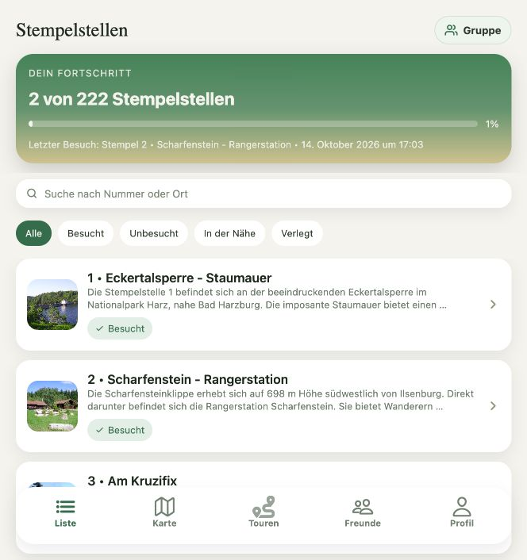

# TODO 01: Fortschrittskarte auf das nächste Sammelziel ausrichten

Status: offen · Priorität: P1 · Aufwand: M

## Beschreibung und Hintergrund

Die Startansicht zeigt Gesamtfortschritt, Prozentwert und letzten Besuch. Ein
Tap auf die Karte führt zur Timeline. Damit ist die Vergangenheit sichtbar,
aber ein erreichbares nächstes Ziel und eine passende Aktion fehlen.

Die vorhandene Karte soll das nächste Sammelziel mit Abzeichenmotiv,
Fortschrittsbalken und verbleibender Anzahl zeigen. Gesamtfortschritt bleibt als
sekundäre Information erhalten. Beispieltexte sind illustrativ. Zielnamen und Freischaltregeln werden mit dem
bestehenden UI5-Abzeichenkatalog aus TODO 02 abgeglichen; neue Fantasieregeln
sollen ihn nicht ersetzen. Die bestehende lange Fortschrittsanimation bleibt erhalten.

## Visuelle Referenz: Ist-Zustand

Lokaler Screenshot vom 14. Oktober 2026. Angemeldetes lokales Testkonto mit regulären lokalen
Stempelstellen und bereits vorhandenen Testbesuchen. Zu beurteilen sind die rückblickende Karte und der Einstieg in
die Liste. Eventuell sichtbare Expo-Diagnosehinweise gehören zur Testumgebung.

## Gewünschter Flow

Start → „Noch 3 Stempel bis zu deinem nächsten Meilenstein“ →
„Fehlende Stempel entdecken“ → gefilterte bestehende Liste → Stempeldetail.

Bei null Stempeln: Buddy, „Dein erster Stempel wartet“ und „Stempel entdecken“.
Bei abgeschlossenem Ziel: das folgende Ziel anzeigen; wenn alle Ziele erreicht
sind, einen würdigenden Abschlusszustand mit Zugriff auf die Sammlung anbieten.
Die Timeline erhält einen separat beschrifteten Einstieg.

## Umsetzung

- [ ] Gemeinsames Zielmodell mit TODO 02 festlegen: Ziel-ID, Titel, Motiv,
  Voraussetzung, aktuelle Anzahl und gegebenenfalls benötigte Stempel-IDs.
- [ ] Nächstes Ziel deterministisch auswählen; keine willkürlichen Wechsel beim Neuladen.
- [ ] Karte mit Zielmotiv, kurzem Titel, verbleibender Anzahl und einer primären Aktion gestalten.
- [ ] Listenfilter für das Ziel übergeben und sichtbar zurücksetzbar machen.
- [ ] Gastzustand erklären; persönlichen Fortschritt erst nach Anmeldung ausweisen.
- [ ] Lade-, Fehler- und Offlinezustand vorsehen; lokale Daten als solche kenntlich machen.

## Abnahmekriterien

- [ ] Ohne Vorkenntnis ist erkennbar, welches Ziel als Nächstes erreichbar ist.
- [ ] CTA öffnet passende Stempelstellen, ohne einen Tourenflow vorauszusetzen.
- [ ] Balken, Zähler und Restanzahl beruhen auf demselben Datenstand.
- [ ] Wiederholte Besuche erhöhen den Fortschritt zu einzigartigen Stempeln nicht.
- [ ] Null-, Zwischen- und Abschlusszustand sind als Screenshots dokumentiert.
- [ ] Screenreader nennt Ziel, Fortschritt und Aktion; reduzierte Bewegung wird respektiert.

## Betroffene Stellen und Abhängigkeiten

- `app/app/(tabs)/index.tsx`: `renderIntro`, Kartenaktion und Listenfilter.
- `app/lib/queries.ts` und gegebenenfalls `app/lib/api.ts`: vorhandene Fortschrittsdaten.
- TODO 02 liefert gemeinsame Regeln; TODO 03 aktualisiert dieselben Werte nach Erfolg.
- Kein neuer Start-Tab und kein Touren-Refactor für diese Aufgabe erforderlich.

## Pattern und Begründung

Duolingo beschreibt einen Einstieg mit eindeutigem nächsten Schritt. Übertragen
wird die Orientierung, während Wanderziele frei wählbar bleiben.
[Duolingo: Home Screen Redesign](https://blog.duolingo.com/new-duolingo-home-screen-design/).
