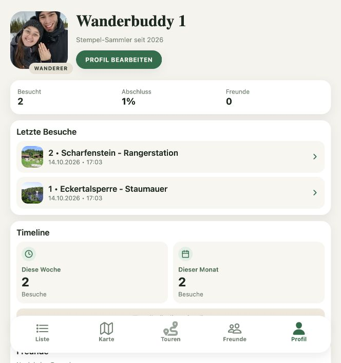

# TODO 02: Profil in ein sichtbares Abzeichenalbum erweitern

Status: offen · Priorität: P1 · Aufwand: M

## Beschreibung und Hintergrund

Das Profil priorisiert Zahlen, Besuche und Listen. Der Titel „WANDERER“ ist fest
hinterlegt. `ProfileView` besitzt bereits eine optionale Sektion für Erfolge,
die das eigene Profil derzeit nicht mit Abzeichen befüllt. In den API-Daten gibt
es einfache textuelle Erfolge; diese sind noch kein belastbares Freischaltsystem.

Ein Abzeichenalbum soll Leistungen sichtbar, verständlich und sammelbar machen.
Die bestehende UI5-App im CAP-Ordner ist die fachliche Ausgangsbasis. Nutzer
wählen selbst die im Profil angezeigten Abzeichen und einen ihrer freigeschalteten
Titel. Noch nicht erreichte Abzeichen bleiben wie offene Stempel ausgegraut
sichtbar; ihre Bedingungen und ihr Fortschritt sind trotzdem einsehbar.

## Visuelle Referenz: Ist-Zustand

Lokaler Screenshot vom 14. Oktober 2026. Die Aufnahme zeigt den tatsächlich
erreichbaren Profilzustand des lokalen Testkontos mit zwei vorhandenen
Testbesuchen; sie ist kein Soll-Mockup. Eventuell sichtbare Expo-Diagnosehinweise
gehören zur Testumgebung.

## Vergleich mit der vorhandenen UI5-App

Die Referenz liegt unter `backend/hwb/app/frontendhwb/webapp/`:

- `controller/List.controller.js`: `onShowBagdesButtonPress` öffnet den Dialog
  und berechnet Fortschritte aus den ausgewählten Stempeln. Hier liegen auch
  die Pflichtstempellisten und die Berechnung der Sonderabzeichen.
- `fragment/BadgeProgressDialog.fragment.xml`: Kategorien „Allgemein“,
  Sonderabzeichen und Kinder; Abzeichenbilder, Zähler, Donut-Fortschritt,
  Bedingungstexte und aufklappbare Pflichtstempel mit Besuchsstatus und Kartenlink.
- `i18n/i18n.properties`: bestehende Abzeichennamen und Beschreibungen.
- `images/badges/`: vorhandene Motive als Ausgangsmaterial übernehmen.

| Abzeichen | Bestehende UI5-Bedingung / Darstellung |
| --- | --- |
| Bronze / Silber / Gold | 8 / 16 / 24 unterschiedliche Stempel |
| Wanderkönig | 50 unterschiedliche Stempel |
| Kaiserrucksack / Kaiserschuh / Wanderkaiser | 100 / 150 / 222 unterschiedliche Stempel |
| Harzer Steiger | 111 unterschiedliche Stempel und alle 23 Bergbau-Pflichtstellen; UI5 zieht fehlende Pflichtstellen vom gedeckelten Fortschrittszähler ab |
| Goethe im Harz | Alle 28 hinterlegten Pflichtstempel |
| Hexen-Stieg | 9 beliebige aus der hinterlegten Auswahl, zusätzlich 69 und 140; Fortschritt maximal 11 |
| Wanderprinzessin / Wanderprinz | 11 unterschiedliche Stempel |
| Grenzweg | Unstimmigkeit: Array enthält 20 reguläre Nummern, Dialog rechnet bis 22, Beschreibung nennt 22 + 3 Sonderstempel |

Die Anforderungen werden aus bestehendem Code beschrieben; das ist keine
unabhängige Bestätigung heutiger offizieller Vergaberegeln. Die Grenzweg-Abweichung
vor Freischaltung fachlich auflösen und Sonderstempel explizit modellieren.

Der Dialog zeigt aktuell die Bildmotive grundsätzlich farbig und feiert erfüllte
Schwellen mit Buddy. Eine persistierte Auswahl hervorgehobener Profilabzeichen,
eine Titelauswahl und das Ausgrauen offener Abzeichen sind in den untersuchten
UI5-Profil-/Dialogstellen nicht implementiert und werden für die neue App ergänzt.
Die neue Berechnung verwendet persönliche eindeutige Besuche statt der zufälligen
aktuellen Mehrfachauswahl einer Liste.

## Gewünschter Flow

Profil → „Abzeichen auswählen“ → gewünschte freigeschaltete Abzeichen markieren
→ Auswahl speichern → genau diese Abzeichen im Profil anzeigen.
Als erste Gestaltung sind bis zu drei hervorgehobene Abzeichen vorgesehen; die
Reihenfolge ist wählbar, auch eine leere Auswahl ist möglich.

Profil → „Titel auswählen“ → einen freigeschalteten Titel oder „Kein Titel“
auswählen → speichern → gewählten Titel beim Namen/Avatar anzeigen.
Keinen Titel automatisch durch den jeweils höchsten Rang ersetzen. Nicht jedes
Abzeichen muss einen Titel verleihen; die Zuordnung von Abzeichen zu Titeln ist
explizit zu definieren, einschließlich der Varianten Wanderprinzessin/Wanderprinz.

„Alle Abzeichen“ → Album → Abzeichendetail mit Bedingung, Fortschritt und
Erwerbsdatum beziehungsweise „Fehlende Stempel entdecken“.

Erreichte Abzeichen: farbiges Motiv und Datum, soweit aus der Historie ableitbar.
Offene Abzeichen: dasselbe erkennbare Motiv ausgegraut, Name und Fortschritt;
Detail ist zugänglich, Auswahl als Profilabzeichen oder Titel bleibt gesperrt.
Ohne Erfolge freundlich zum ersten Stempel führen.

## Umsetzung

- [ ] Bestehenden UI5-Katalog samt Bildern, Namen, Schwellen und Pflichtstempeln
  in ein gemeinsames, dokumentiertes Modell übertragen; Grenzweg-Differenz klären.
- [ ] Persönliche Fortschritte für allgemeine und Sonderabzeichen getrennt
  berechnen; Titelzuordnung und fachlich bestätigte Freischaltbedingungen festlegen.
- [ ] Auswahl und Reihenfolge der Profilabzeichen sowie einen ausgewählten Titel
  pro Nutzer dauerhaft speichern und beim Profilabruf laden. Fehlende bestehende
  Datenfelder/API ergänzen; Auswahl serverseitig gegen Freischaltungen prüfen.
- [ ] Eigene Auswahl bearbeiten können; fremde Profile zeigen nur deren gespeicherte Auswahl.
- [ ] Gesperrte Abzeichen wie offene Stempel ausgrauen, mit lesbarem Fortschritt
  und zusätzlicher Statuskennzeichnung; für Profilanzeige nicht auswählbar machen.
- [ ] Gemeinsame Berechnung für TODO 01, 02 und 03 implementieren; historische
  Besuche berücksichtigen und Wiederholungen korrekt behandeln.
- [ ] Motive mit einheitlicher Silhouette und klar unterscheidbaren Zuständen gestalten.
- [ ] Profilvorschau, Album und Abzeichendetail mit vorhandener Navigation verbinden.
- [ ] Bei abgeleitetem Erwerbsdatum den ersten erfüllenden Besuch verwenden;
  unvollständige Historie nicht mit einem erfundenen Datum ergänzen.

## Abnahmekriterien

- [ ] Profil zeigt erreichte und erreichbare Ziele auch bei null Erfolgen verständlich.
- [ ] Bedingung und tatsächlicher Fortschritt sind für jedes Abzeichen einsehbar.
- [ ] Bereits berechtigte Nutzer erhalten ihre Erfolge beim Einstieg rückwirkend.
- [ ] Gewählte Abzeichen, Reihenfolge und Titel überstehen Neuladen und erneute Anmeldung.
- [ ] Nur freigeschaltete Titel sind auswählbar; gewählter Titel erscheint am Profil.
- [ ] Keine Auswahl ist möglich; freigeschaltete Optionen werden nicht automatisch aufgedrängt.
- [ ] Fremde Profile zeigen die Auswahl ihres Besitzers, nicht die des Betrachters.
- [ ] Offene Motive sind ausgegraut und als gesperrt beschriftet; Details bleiben zugänglich.
- [ ] Entfernte/korrigierte Besuche werden nach einer festgelegten Regel behandelt;
  aktueller Status wird aus der aktuellen Historie neu berechnet. Nicht mehr
  berechtigte angezeigte Abzeichen und Titel werden aus der aktiven Auswahl
  entfernt; die UI erklärt die Änderung ohne einen Ersatz automatisch auszuwählen.
- [ ] Offline wird vorhandener Stand angezeigt; ein Ladefehler wirkt nicht wie ein leerer Erfolgskatalog.
- [ ] Status ist ohne reine Farberkennung verständlich; lange Titel und große Schrift passen.
- [ ] Screenshots für leeres Album, gemischtes Album und freigeschaltetes Detail liegen vor.

## Betroffene Stellen und Abhängigkeiten

- `app/components/profile-view.tsx`: Avatar-Titel und optionale Erfolge-Sektion.
- `app/app/(tabs)/profile.tsx`: Übergabe der Profil- und Erfolgsdaten.
- `app/lib/api.ts`: vorhandene textuelle `achievements` und Besuchshistorie.
- UI5-Referenzen und vorhandene Bildmotive siehe Vergleich oben.
- `app/app/profile/edit.tsx`, CAP-Profilschema und Profil-API: persistierte Auswahl
  ergänzen; bisherige textuelle Erfolge reichen dafür nicht aus.
- Neues gemeinsames Zielmodell erforderlich; kein manueller Versionsbump.

## Pattern und Begründung

Duolingo gestaltet Achievements als visuelle Belohnungen mit leicht erreichbaren
Einstiegszielen und anspruchsvolleren Abzeichen. Komoot macht persönliche
Aktivitätsstatistiken im Profil zugänglich. Für den Wanderbuddy verbindet das
Album die vorhandenen Zahlen mit konkreten Sammelobjekten.
[Duolingo: Achievement Badges](https://blog.duolingo.com/achievement-badges/),
[Komoot: Activity Statistics](https://support.komoot.com/hc/en-us/articles/10360951736858-View-and-filter-your-activity-statistics).
