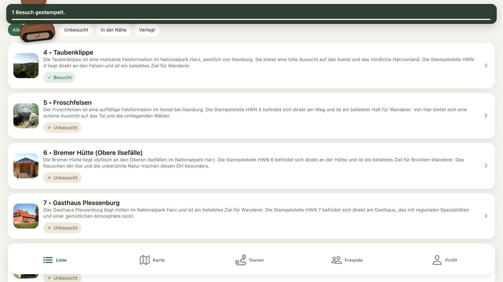

# TODO 03: Erfolgreiches Stempeln als Fortschrittsmoment gestalten

Status: offen · Priorität: P1 · Aufwand: S–M

## Beschreibung und Hintergrund

Stempeln ist an drei Orten möglich: **Liste, Details und Karte**. Alle drei
Einstiege gehören verbindlich zu dieser Aufgabe. Die Stempelanimation existiert bereits. Anschließend bestätigt ein kurzlebiger
Toast die Speicherung mit „Stempel erfolgreich gesetzt.“ beziehungsweise einem
Gruppenhinweis. Die Bedeutung für Sammlung und nächstes Ziel wird nicht gezeigt.

Die bestehende Animation soll durch eine kompakte Erfolgskarte ergänzt werden.
Sie bestätigt den Ort und zeigt den tatsächlich hinzugewonnenen Fortschritt.

## Visuelle Referenz: Ist-Zustand

Vorhandener Repository-Screenshot aus `docs/screenshots/stamp-list-multi-select/`;
Aufnahmedatum unbekannt, Desktopansicht. Er zeigt die bestehende Animation und
den Toast „1 Besuch gestempelt.“; kein neu erzeugter Erfolg und kein Soll-Entwurf.

## Gewünschter Flow

Stempeln → Speichern → bestätigter Erfolg → „Brockenhaus gesammelt!“ →
„37 → 38 einzigartige Stempel“ und aktualisiertes Ziel → „Weiter entdecken“.
Die Zahlen sind ein illustratives Textbeispiel.

Bei einem neuen Meilenstein zeigt dieselbe Karte das Abzeichen und Buddy mit
„Abzeichen ansehen“. Bei wiederholtem Besuch: „Besuch festgehalten“ mit Datum,
ohne zusätzlichen einzigartigen Stempel. Normale Erfolge bleiben kurz und
unaufdringlich, Meilensteine erhalten eine bewusst stärkere Inszenierung.

## Umsetzung

- [ ] Gemeinsames Erfolgsereignis für Liste, Karte und Stempeldetail definieren:
  betroffene Orte, neue eindeutige Stempel, Wiederholungsbesuche und neue Ziele.
- [ ] Erfolgskarte mit Ortsname, Fortschrittsänderung und nächster Aktion erstellen.
- [ ] Erst nach bestätigter Speicherung belohnen; bestehende optimistische Updates
  bei Fehlern weiterhin zurücknehmen. Kein Erfolg bei bloßem Tastendruck.
- [ ] Mehrfachauswahl zu einer Zusammenfassung bündeln, statt viele Karten zu öffnen.
- [ ] Bei Gruppenaktionen nur tatsächlich bestätigte Beiträge ausweisen;
  eigenen Fortschritt getrennt vom Gruppenfortschritt darstellen.
- [ ] Mehrfachauslösung, verspätete Antworten und Navigation während des Speicherns behandeln.
- [ ] Haptik-Einstellungen und reduzierte Bewegung beachten; keine Pflichtanimation.

## Abnahmekriterien

- [ ] Liste: Einzel-/Mehrfachaktion zeigt korrekte Erfolgszusammenfassung.
- [ ] Details: erster und wiederholter Besuch zeigen das jeweils passende Feedback.
- [ ] Karte: direktes Stempeln aus dem Bottomsheet zeigt dasselbe Erfolgsmodell.
- [ ] Gruppenstempeln wird an den verfügbaren Einstiegen ebenfalls berücksichtigt.
- [ ] Ein gemeinsamer Erfolg wird nicht mehrfach über mehrere Ansichten gefeiert.
- [ ] Neuer Ort, Wiederholungsbesuch und Mehrfachauswahl erhalten korrektes Feedback.
- [ ] Fehler, Offlineblockade und unbestätigte Speicherung lösen keine Belohnung aus.
- [ ] Ein freigeschaltetes Abzeichen wird pro erfolgreichem Ereignis einmal gefeiert.
- [ ] Liste, Profil und Karte zeigen nach Abschluss konsistente Werte.
- [ ] Erfolg überdeckt keine notwendige Navigation; Aktion und Schließen sind erreichbar.
- [ ] Screenshots dokumentieren normalen Erfolg, Wiederholung und Meilenstein.

## Betroffene Stellen und Abhängigkeiten

- `app/components/stamping-success-toast.tsx`, `stamp-press-stage.tsx`,
  `animated-stamp.tsx` und `completion-confetti.tsx` als vorhandene Grundlage.
- `app/app/stamps/[id].tsx`, `app/app/(tabs)/index.tsx` und Kartenaktionen.
- TODO 02 wird nur für Abzeichen benötigt; bessere normale Erfolgsbestätigung
  lässt sich vorher liefern. Keine zusätzliche Touren-Abschlussansicht.

## Pattern und Begründung

Duolingo beschreibt die bewusste Gestaltung belohnender Animationen und besonderer
Meilensteine. Übertragen wird die sichtbare Bedeutung eines Erfolgs; der Rhythmus
richtet sich nach tatsächlichen Wanderausflügen.
[Duolingo: Streak and Milestone Design](https://blog.duolingo.com/how-duolingo-streak-builds-habit/).
