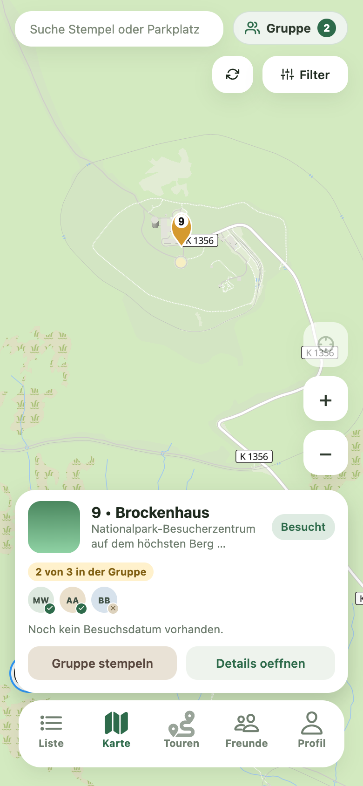

# TODO 04: Stempelkarten als attraktive Entdeckungen gestalten

Status: offen · Priorität: P2 · Aufwand: S–M

## Beschreibung und Hintergrund

Stempelkarten zeigen kleine Fotos oder abstrakte Farbverläufe, teilweise lange
abgeschnittene Beschreibungen und „× Unbesucht“. Die Ortsbesonderheit und der
Sammelcharakter treten hinter dem Verwaltungsstatus zurück. Liste und
Karten-Bottomsheet sollen denselben Ort unmittelbar wiedererkennbar darstellen.

## Visuelle Referenz: Ist-Zustand

Vorhandener Repository-Screenshot aus `docs/screenshots/map-group-stamp-status/`.
Mobile Browseransicht mit 390 × 844 CSS-Pixeln, Pixelverhältnis 2. Laut dortiger
README wurden OData-Antworten nur im Screenshot-Browser durch Demo-Daten ersetzt.
Fehlende Fotos sind in dieser Aufnahme bewusst gewählt. Der Screenshot belegt
die Gestaltung, nicht einen produktiven Bildladefehler.

## Gewünschter Flow und Gestaltung

Liste oder Kartenmarker → wiedererkennbare Ortskarte → Detail.
Foto und Ortsname dominieren. Die Stempelnummer bekommt ein kleines eigenes
Siegel. Darunter stehen maximal zwei verlässliche Informationen, etwa ein
vorhandener Ortstyp und „2,4 km Luftlinie“. Fehlende Angaben werden ausgelassen.
Unbesuchte Orte erhalten „Noch entdecken“ mit neutralem Sammelsymbol;
besuchte behalten eine klare Bestätigung. Gruppenstatus bleibt sichtbar.

## Umsetzung

- [ ] Gemeinsame Bild-, Nummern-, Titel- und Statusdarstellung für Liste und Sheet festlegen.
- [ ] Fotoausschnitt vergrößern und Langbeschreibung zugunsten kurzer relevanter Metadaten reduzieren.
- [ ] Vorhandene Bildquellen weiterverwenden; für fehlende/defekte Bilder eine
  passende Harz-Illustration oder ein gestaltetes Ortsmotiv anbieten.
- [ ] Distanz nur bei vorhandenen Koordinaten und freigegebenem Standort zeigen;
  ausdrücklich als Luftlinie beschriften und nicht als Gehstrecke ausgeben.
- [ ] Keine neuen Ortstypen oder Merkmale aus Beschreibungstexten erfinden;
  strukturierte Daten nutzen oder die Angabe weglassen.
- [ ] Auswahlmodus, lange Namen, verlegte Stempel und Gruppenavatare integrieren.
- [ ] Virtualisierte Zeilenhöhen anpassen, falls die Kartenhöhe verändert wird.

## Abnahmekriterien

- [ ] Derselbe Ort ist in Liste und Bottomsheet visuell wiedererkennbar.
- [ ] Mit Foto, ohne Foto und bei Bildladefehler entstehen vollständige Karten.
- [ ] Status, Stempelnummer und Ortsname bleiben bei großer Schrift verständlich.
- [ ] Ohne Standortfreigabe erscheinen keine erfundenen Distanzen und kein blockierender Prompt.
- [ ] Gruppenstatus und Mehrfachauswahl funktionieren wie zuvor.
- [ ] Neue Karten erzeugen keine störenden Layoutsprünge beim Scrollen.
- [ ] Mobile Screenshots zeigen die drei Bildzustände und eine aktive Gruppe.

## Betroffene Stellen und Abhängigkeiten

- `app/components/stamp-list-item.tsx` und `map-selection-sheet.tsx`.
- `app/app/(tabs)/index.tsx`: bekannte Zeilenhöhen und Fast-Scroller.
- `app/lib/images.ts`: bestehende authentifizierte Bildquellen.
- Keine neuen Tourenkarten, Routenberechnung oder Planungsflows.

## Pattern und Begründung

Komoot macht interessante Orte als Highlights auf der Karte auffindbar und führt
zu eigenen Detailseiten. Für den Wanderbuddy wird das auf vorhandene
Stempelstellen übertragen: attraktive Ortsvorschau mit klarer Detailaktion.
[Komoot: Highlights](https://support.komoot.com/hc/en-us/articles/360058904532-Highlights-displayed-on-the-map).
