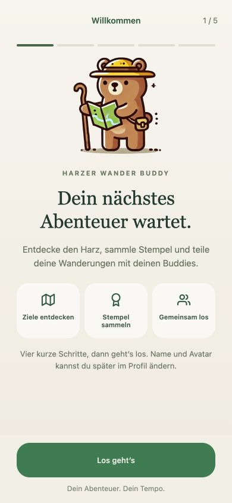

# TODO 05: Typografie, Flächen und Bewegung vereinheitlichen

Status: offen · Priorität: P1 · Aufwand: S–M

## Beschreibung und Hintergrund

Viele weiße Karten, Schatten, Chips und verschachtelte Flächen haben ähnliches
visuelles Gewicht. Schriftdefinitionen sind teils zentral, teils direkt in den
Ansichten hinterlegt. Die Startkarte animiert Zähler und Balken über 3,9 Sekunden.
Ein klares System soll die vorhandene naturverbundene Gestaltung präziser und
ruhiger machen und den folgenden TODOs eine gemeinsame Grundlage geben.

## Visuelle Referenzen: Ist-Zustand

Lokale Aufnahme vom 14. Oktober 2026. Relevant sind das Gewicht der
Fortschrittskarte, die Kartenflächen, die Filter und die schwebende Tabbar.

Vorhandener Screenshot aus `docs/screenshots/guided-onboarding/01-welcome.jpg`;
Aufnahmedatum unbekannt. Buddy, Naturfarben und prägnante Überschrift sind eine
vorhandene gestalterische Grundlage, kein neuer Entwurf.

## Gewünschte Gestaltung

Einheitliche Titelposition, klar definierte Textrollen, Abstände und Radien.
Eine dominante Fläche je Ansicht; sekundäre Abschnitte werden bevorzugt durch
Weißraum getrennt. Schatten betonen vor allem tatsächlich schwebende Elemente.
Pro Handlungsbereich ist die primäre Aktion klar erkennbar.

Die bestehende lange Fortschrittsanimation von **3,9 Sekunden bleibt auf
ausdrücklichen Nutzerwunsch erhalten**, einschließlich des animierten Zählers.
Sie ist Teil des gewünschten Erlebnisses und wird in dieser Aufgabe weder
verkürzt noch auf besondere Meilensteine beschränkt. Balken und Zähler laufen
synchron; Bedienung und Navigation bleiben währenddessen möglich. Die
barrierefreie Alternative bei aktivierter reduzierter Bewegung bleibt vorgesehen.

## Umsetzung

- [ ] Kleine gemeinsame Tokens für Markenfarben, semantische Statusfarben,
  Schriftrollen, Abstände, Radien, Schatten und Animationsdauer festlegen.
- [ ] Lesbare Schriftfamilien je Plattform bestimmen; Serifentitel und UI-Schrift
  bewusst kombinieren, ohne plattformspezifische Zufallswechsel.
- [ ] Zunächst Liste, Profil, Freunde und Karten-Bottomsheet angleichen.
- [ ] Verschachtelte Karten und gleichgewichtige Schatten gezielt reduzieren;
  dabei Zusammengehörigkeit von Inhalten erhalten.
- [ ] Primär-, Sekundär- und destruktive Buttons mit einheitlichen Zuständen versehen.
- [ ] Fortschrittsbalken und Zähler gemeinsam aktualisieren; bei reduzierter
  Bewegung den Endstand direkt anzeigen.
- [ ] Deutsche UI-Texte in den angefassten Ansichten vereinheitlichen,
  beispielsweise Umlaute in „öffnen“ und „schließen“.

## Abnahmekriterien

- [ ] Vergleichbare Header, Buttons und Chips folgen in den vier Ansichten denselben Regeln.
- [ ] Balken und Zahlen widersprechen sich während der Aktualisierung nicht.
- [ ] Fortschrittsbalken und Zähler behalten die vorhandene Dauer von 3,9 Sekunden.
- [ ] Die lange Animation blockiert keine Aktion und wird nicht durch neue Tokens verkürzt.
- [ ] Standardtexte erfüllen mindestens 4,5:1 Kontrast; große Texte und relevante
  UI-Grenzen mindestens 3:1. Zustände sind zusätzlich durch Text/Symbol erkennbar.
- [ ] Primäre Touchziele sind mindestens 44 × 44 logische Pixel groß.
- [ ] Große Schrift, lange Namen und reduzierte Bewegung sind geprüft.
- [ ] Vorher-/Nachher-Screenshots der vier Ansichten liegen der Umsetzungs-PR bei.

## Betroffene Stellen und Abhängigkeiten

- `app/constants/theme.ts`: gemeinsame Grundlagen.
- `app/app/(tabs)/_layout.tsx`, `index.tsx`, `friends.tsx`.
- `app/components/profile-view.tsx` und `map-selection-sheet.tsx`.
- Bestehende Tourenoberflächen für den späteren Refactor dokumentieren;
  globale Token-Änderungen dürfen sie nicht unbeabsichtigt verschlechtern.

## Pattern und Begründung

Duolingos dokumentierter Tab-Refresh adressiert uneinheitliche Header,
Typografie, Abstände und unnötige Container. Entscheidend ist die konsistente
Hierarchie mit einem zur jeweiligen Ansicht passenden Schwerpunkt.
[Duolingo: Core Tabs Redesign](https://blog.duolingo.com/core-tabs-redesign/).
